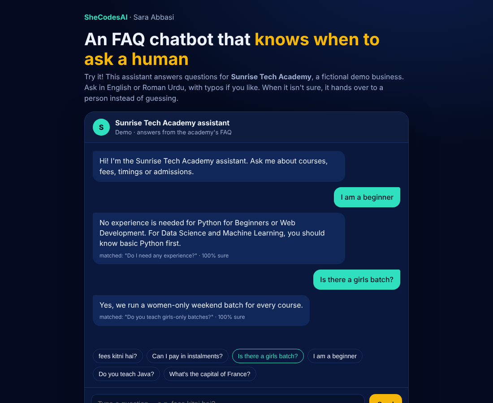

# AI FAQ Chatbot

**A customer-support chatbot that answers from a business's own FAQ, and knows when to hand over to a human.**

### ▶ [Try the live demo](https://abbasisarah.github.io/demos/faq-chatbot/)



Most small businesses answer the same 20 questions all day on WhatsApp: *fees? timings? next batch? location?* This bot answers them instantly, any time of day, in English or Roman Urdu. When a question isn't in the FAQ, it **doesn't make something up**: it passes the question to the team.

## What it can do
- **Understands different wordings:** "How much are the fees?", "course price" and "fees kitni hai" all find the same answer.
- **Handles typos:** "feez kitni hy" still works.
- **Knows its limits:** "What's the capital of France?" scores 14% confidence, so the bot hands it to a human instead of guessing.
- **Shows its confidence** for every answer, so the business can see where the FAQ needs more wordings.
- **Runs in the browser** with no server and no API costs, and no customer data leaves the page.

## How it works
1. Each FAQ question, plus other ways of asking it (`alt` in `faq.json`), is turned into numbers with **TF-IDF**. It uses two views:
   - **whole words** (and word pairs), for meaning;
   - **3–4 letter chunks**, so typos and spelling variants still match.
2. Filler words like *what, is, the, kya, hai* are ignored, so they can't cause false matches.
3. A new question gets the same treatment, and **cosine similarity** finds the closest FAQ.
4. If the best match is below **35% confidence**, the bot hands over to a human.

The same method is written twice: `faq_bot.py` (Python) and `web/bot.js` (browser). Both give the same answers.

## Run it
```bash
pip install -r requirements.txt
python faq_bot.py                      # chat in the terminal
python faq_bot.py "fees kitni hai"     # one question
python -m pytest                       # 4 tests
python build_web.py                    # rebuild the web page after editing faq.json
```

## Use it for your own business
Edit `faq.json`: replace the questions, answers, greeting and fallback message. Add 3–6 `alt` wordings per question, including the way your customers actually write. Then run `python build_web.py` and open `web/index.html`.

## Ideas to extend it
- Connect it to **WhatsApp Business** or a website chat widget
- Use an **AI model (LLM)** to rewrite answers more naturally, while still only using the FAQ's facts
- Log the questions it couldn't answer, to know what to add to the FAQ

*Sunrise Tech Academy is a fictional demo business; the phone number, address and email are placeholders.*

---
**Want a chatbot or automation for your business?** Sara Abbasi · [abbasisarah.github.io](https://abbasisarah.github.io) · [GitHub](https://github.com/AbbasiSarah) · Instagram [@shecodess.ai](https://www.instagram.com/shecodess.ai/)
